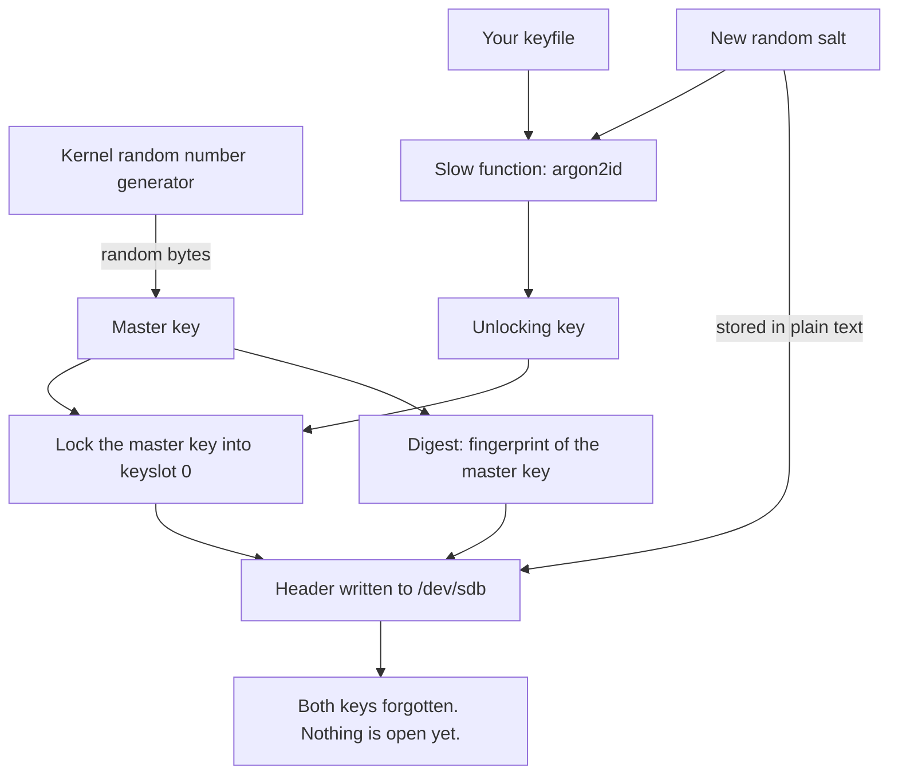
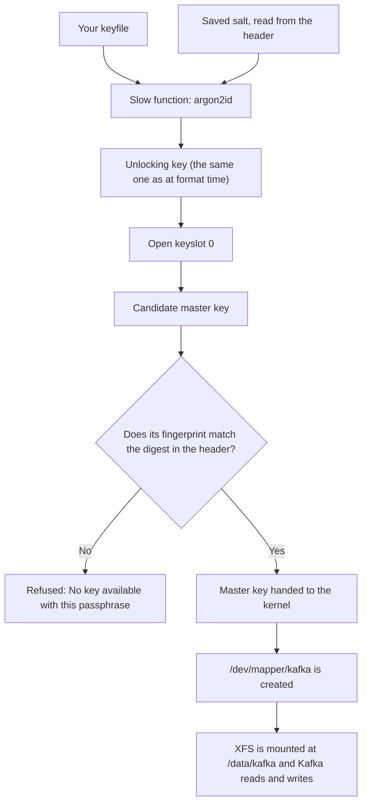
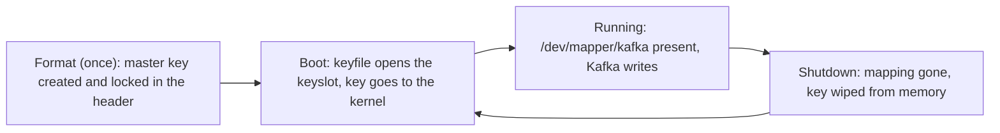

# Case study, part 2: how the keys work on the Kafka broker

[← Home](../README.md) · Part 1: [The layers on a Kafka broker](08-case-study-kafka-broker.md) · Part 3: [Rotating the keyfile](10-case-study-kafka-key-rotation.md) · Related: [Lesson 2](02-master-key.md), [Lesson 3](03-keyslots.md), [Lesson 4](04-key-derivation.md)

Part 1 covered the layers from `/dev/sdb` up to `/data/kafka`. This part follows the keys: what happens when the disk is formatted, what happens every time it is opened, and what the LUKS header does and does not hold.

The setup is the same: a Kafka broker whose data disk `/dev/sdb` is encrypted with LUKS and unlocked at boot with a **keyfile**.

## The whole thing in one line

```
keyfile ─► slow function ─► unlocking key ─► opens keyslot ─► master key ─► kernel ─► /dev/mapper/kafka
           (+ saved salt)
```

## The cast

Think of a **lockbox**. The master key is the valuable thing; the keyslot is a lockbox in the header that holds it; the unlocking key opens the lockbox.

| Name | What it is | Who creates it | Where it lives | Secret? |
|---|---|---|---|---|
| **Keyfile** | What you supply to unlock the disk. A file of random bytes. (A passphrase plays the same role.) | You | Wherever you keep it. **Never in the header.** | Yes |
| **Salt** | A random number mixed into the slow function | `cryptsetup`, once, when the keyslot is created | In the header, in plain text | No |
| **Slow function** | argon2id. Turns keyfile + salt into the unlocking key, deliberately slowly | Built into `cryptsetup` | Its settings are in the header | No |
| **Unlocking key** | The key to the lockbox. Opens one keyslot and does nothing else | Recalculated every time | **Nowhere.** Used and thrown away | Yes |
| **Keyslot** | The lockbox: holds the master key in locked form | `cryptsetup` | In the header | The contents are locked |
| **Master key** | The key that actually encrypts and decrypts the data | `cryptsetup`, from the kernel's random number generator | Locked in the keyslot; in kernel memory while the volume is open | Yes, the most important one |
| **Digest** | A fingerprint of the master key, used to check an unlock worked | `cryptsetup` | In the header | No |

Two keys, two jobs: the **unlocking key** opens the lockbox, the **master key** opens the data.

## What the header holds

```
/dev/sdb
┌──────────────────────────────────────────────────────────────┐
│ LUKS HEADER                                                  │
│                                                              │
│   Metadata      version, UUID, cipher (aes-xts-plain64),     │
│                 where the data starts                        │
│                                                              │
│   Keyslot 0     salt ................. plain text            │
│                 slow-function settings  plain text           │
│                 master key ........... LOCKED                │
│                                                              │
│   (Keyslot 1…)  more lockboxes, each holding the same        │
│                 master key behind a different lock           │
│                                                              │
│   Digest        fingerprint of the master key                │
├──────────────────────────────────────────────────────────────┤
│ ENCRYPTED DATA  everything Kafka writes, as ciphertext       │
└──────────────────────────────────────────────────────────────┘
```

**In the header:** how the disk is encrypted, the salt, the locked master key, the digest.

**Not in the header:** the keyfile, the unlocking key, the master key in the clear.

## Formatting: `cryptsetup luksFormat /dev/sdb`

Done **once**, when the server is built. This is where the master key and the first keyslot are born.



Step by step:

1. `cryptsetup` asks the kernel for random bytes. **That is the master key.** Nobody types it or sees it.
2. It generates a random **salt**.
3. It runs keyfile + salt through the slow function to get the **unlocking key**.
4. It locks the master key into **keyslot 0** using the unlocking key.
5. It computes the **digest** of the master key.
6. It writes the header to the disk and forgets both keys.

After formatting, the master key exists only in locked form inside the header. The kernel is **not** holding it: its only part in formatting was to supply random bytes.

Formatting also does not encrypt anything already on the disk. It writes a fresh header, and whatever was there before is lost.

## Opening: `cryptsetup open /dev/sdb kafka`

Done at **every boot**. This is the moment the master key enters kernel memory.



Step by step:

1. `cryptsetup` reads the header from `/dev/sdb`.
2. It runs your keyfile and the **saved** salt through the slow function. Same keyfile, same salt, so the same unlocking key as at format time.
3. It opens the keyslot and gets a candidate master key.
4. It fingerprints the candidate and compares the result with the digest. A wrong keyfile produces garbage here and is refused.
5. On a match, it hands the master key to the **kernel**.
6. The kernel creates `/dev/mapper/kafka` and uses the key for every read and write from then on.

The slow function is run by the `cryptsetup` program. The kernel only comes in at step 5.

## When is the master key in kernel memory?

| State | `/dev/mapper/kafka` | Master key in kernel memory |
|---|---|---|
| Just formatted, never opened | absent | no |
| Opened | present | **yes** |
| Closed (`cryptsetup close kafka`) | gone | wiped |
| Powered off or rebooted | gone | wiped |

The rule: **if you can see `/dev/mapper/kafka`, the key is in memory.** The two always go together.

## The life of the disk



## The "why" questions

**Why does the header not need to remember the keyfile?**
Because it can test a keyfile without knowing it. It runs whatever you supply through the slow function, tries the result on the lockbox, and checks the fingerprint of what comes out. The right keyfile yields the right master key; anything else yields garbage that fails the check. Storing the keyfile would only give an attacker something to steal.

**Why is it safe to store the salt in plain text?**
The salt is useless on its own. The unlocking key needs the keyfile *and* the salt, and the attacker still lacks the keyfile.

**Then what is the salt for?**
It makes the same keyfile or passphrase produce a different unlocking key on every disk. Without it, an attacker could work out the unlocking keys for common passphrases once and reuse that list against every LUKS disk in the world.

**Does the salt change on every unlock? Would that not make the keyslot impossible to open?**
No. The salt is generated once, when the keyslot is created, and saved. Every unlock reads the same saved salt, so the same keyfile always gives the same unlocking key. The uniqueness is between disks, not between attempts.

**Why is the function slow?**
To make guessing expensive. Each guess costs an attacker a second or two and a large block of memory. This matters most for human passphrases; a keyfile of random bytes is not realistically guessable anyway, but LUKS uses the same mechanism for both.

**Nobody created the master key, so where did it come from?**
`cryptsetup` generated it from the kernel's random number generator during `luksFormat`. A random machine-made key is far stronger than anything a person would choose, and you never need to handle it.

**Why two keys instead of encrypting the data with the keyfile directly?**
Because the keyfile can then be replaced in seconds: only the small lockbox is re-locked, and the data, still encrypted with the same master key, is untouched. It also allows several keyslots, for example a keyfile for boot plus a recovery passphrase, all opening the same data.

**Can anyone see the master key in kernel memory?**
Not casually. On modern systems it sits in the kernel keyring and ordinary tools show only a reference to it. But it is hidden, not out of reach: anyone with a valid keyfile or passphrase can print it with `cryptsetup luksDump --dump-volume-key`, and an attacker with full control of the running machine can extract it from memory.

## A real-world caution: where the keyfile lives

At boot, `/etc/crypttab` runs the open step, with a line such as:

```
kafka  UUID=<uuid of /dev/sdb>  /etc/keys/kafka.key  luks
```

The keyfile is now the thing to protect. If it sits on the same server's unencrypted system disk, anyone who takes the whole server gets the keyfile and the encrypted disk together. That setup still protects a data disk that is pulled on its own, but not a stolen machine. Stronger arrangements keep the key off the machine's disks, in a TPM chip or a key-management service.

## Misunderstandings corrected along the way

| It is tempting to think | What actually happens |
|---|---|
| The header holds only cipher details | It also holds the master key, locked inside a keyslot |
| The header stores the keyfile or passphrase | It stores neither; it tests what you supply |
| The salt changes on each unlock | It is created once and reused |
| Formatting loads the key into the kernel | Only opening does |
| The key stays in memory from the day the disk was formatted | Memory is wiped at every reboot; the volume is re-opened at each boot |
| The kernel runs the slow function | `cryptsetup` does; the kernel receives the finished master key |

## See it for yourself

[Lab 1](../labs/01-create-and-inspect.md) formats a disk and prints its header. Every item in the cast that lives in the header is visible in `cryptsetup luksDump`:

```
Keyslots:
  0: luks2                          ◄── the lockbox
	PBKDF:      argon2id            ◄── the slow function
	Time cost:  7                   ◄── its settings
	Memory:     1048576
	Salt:       11 e2 c3 c8 ...     ◄── the salt, in plain text
Digests:
  0: pbkdf2
	Digest:     03 26 56 ca ...     ◄── fingerprint of the master key
```

What you will *not* find in the dump is the master key or anything derived from your passphrase.

- [Lab 3](../labs/03-keyslots.md): add more lockboxes and open the disk with a keyfile
- [Lab 5](../labs/05-master-key-in-kernel.md): see the kernel's reference to the key, then print the master key itself

## Quick revision

Cover the answers and try these.

1. What is inside a keyslot?
2. Where is the unlocking key stored?
3. When is the master key created, and by what?
4. When does the master key enter kernel memory?
5. Why can the salt be stored in plain text?
6. How does LUKS know a keyfile is correct without storing it?

<details>
<summary>Answers</summary>

1. The master key, in locked form.
2. Nowhere. It is recalculated from the keyfile and the saved salt at every unlock, then discarded.
3. At `luksFormat`, by `cryptsetup`, from the kernel's random number generator.
4. At `cryptsetup open`, the same moment `/dev/mapper/kafka` appears. Not at format time.
5. It is useless without the keyfile. Its job is to make unlocking keys differ between disks, not to be secret.
6. It derives an unlocking key from what you supply, opens the keyslot with it, and compares the fingerprint of the result with the digest in the header.

</details>
