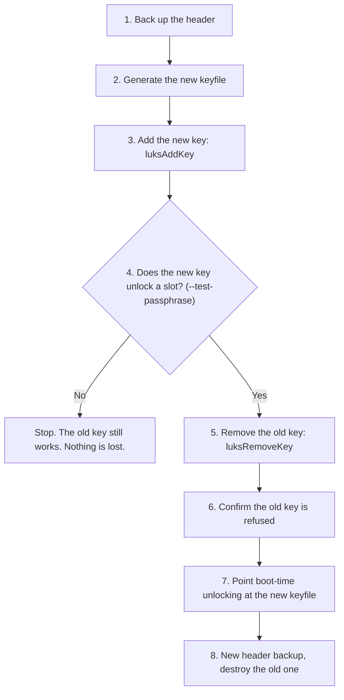

# Case study, part 3: rotating the keyfile on the Kafka broker

[← Home](../README.md) · Part 1: [The layers](case-study-kafka-broker.md) · Part 2: [How the keys work](case-study-kafka-keys.md) · Hands-on: [Lab 11](../labs/11-rotate-a-keyfile.md)

The security team needs to replace the keyfile on a broker that holds 2 TB of Kafka data. The change takes seconds, not hours, and Kafka keeps running. This part explains why that is possible, and why the order of the commands matters so much.

## Why it is fast

Every block of the 2 TB is encrypted with the **master key**. The keyfile does not encrypt any data: it only opens the lockbox (keyslot) in the header that holds the master key.

Picture a house full of locked rooms, all opened by one master key. That master key sits in a small lockbox by the front door. Rotating the keyfile changes the lock on the lockbox. The master key stays the same, so none of the rooms needs re-locking.

```
Before:   keyslot 0  [ master key ]  opened by old.key
After:    keyslot 1  [ master key ]  opened by new.key      same master key, same data
```

## Why it is delicate

The master key cannot be regenerated. It exists only inside the keyslots. If the last working keyslot is lost, the header can still be read, but the master key is gone and the data is permanently unreadable, even to someone holding every keyfile ever issued.

So the procedure is built around one rule: **never have fewer than one proven-working keyslot.**

## The procedure



> These commands show the procedure on the case-study broker. Practise it in [Lab 11](../labs/11-rotate-a-keyfile.md) before going near a real disk.

| Step | Command | Why |
|---|---|---|
| 1 | `cryptsetup luksHeaderBackup /dev/sdb --header-backup-file pre-rotation.bak` | Safety net. If a keyslot is damaged, this restores it. |
| 2 | `dd if=/dev/urandom of=new.key bs=64 count=1` and `chmod 600 new.key` | The new keyfile: random bytes, readable only by its owner. |
| 3 | `cryptsetup luksAddKey /dev/sdb new.key --key-file old.key` | Adds a second lockbox. Both keys now work. |
| 4 | `cryptsetup open --test-passphrase --verbose /dev/sdb --key-file new.key` | Proves the new key opens a slot, without opening the volume. |
| 5 | `cryptsetup luksRemoveKey /dev/sdb old.key` | Removes the old lockbox. The point of no easy return. |
| 6 | `cryptsetup open --test-passphrase /dev/sdb --key-file old.key` | Should now fail. Confirms the old key is retired. |
| 7 | Update the keyfile that `/etc/crypttab` points to | Otherwise the next boot tries the old key and the disk does not open. |
| 8 | New `luksHeaderBackup`; securely delete `pre-rotation.bak` | An old backup still contains the old keyslot. |

All of this works while the volume is open and Kafka is running. An open volume uses the master key already in kernel memory and never consults the keyslots.

## What `luksAddKey` does inside

```
cryptsetup luksAddKey /dev/sdb new.key --key-file old.key
                      │        │       └── proves you're allowed: opens an existing keyslot
                      │        └────────── the new key to add
                      └─────────────────── the disk whose header is changed
```

1. `old.key` and keyslot 0's saved salt go through the slow function, giving the unlocking key for keyslot 0.
2. Keyslot 0 is opened and the master key is read out of it.
3. A **new** random salt is generated for the new keyslot.
4. `new.key` and that salt go through the slow function, giving a different unlocking key.
5. The **same** master key is locked into keyslot 1.

| | Keyslot 0 | Keyslot 1 |
|---|---|---|
| Opened by | `old.key` | `new.key` |
| Salt | original, untouched | newly generated |
| Contains | the master key | the same master key |

The master key is copied from the existing *keyslot*, not from `old.key`. Nobody on the security team sees or handles it; `cryptsetup` holds it in its own memory for a moment and discards it. No new master key is requested from the kernel.

## The command that must never be used here

`cryptsetup luksFormat` is not a way to set a new key. It always starts over: a brand-new master key and a new header. The old master key is destroyed, and the existing 2 TB becomes permanently unreadable.

| You want to | Use | Never |
|---|---|---|
| Add a key | `luksAddKey` | |
| Replace a key | `luksAddKey`, test, `luksRemoveKey` | `luksFormat` |
| Replace the master key | `reencrypt` | `luksFormat` |

## Why not the one-step command?

`cryptsetup luksChangeKey` replaces a key in one go. It is not reckless: when a spare keyslot is free, it writes the new slot before removing the old one. Its weaknesses are narrower:

- **No test window.** By the time it returns, the old key is already gone.
- **A full header.** If every keyslot is in use, it has to overwrite the old slot in place, and an interruption at that moment can leave the slot unusable.

Add-then-remove costs one extra command and buys a moment where both keys work and the new one can be verified.

## What can go wrong

| Mistake | Result | What prevents it |
|---|---|---|
| The new keyfile is corrupt or not the file you think it is | New slot can't be opened | Step 4, before the old key is removed |
| Old key removed before the new one was tested | Possibly no working key at all | The order: add, test, remove |
| Last keyslot removed | Data permanently unreadable | A header backup; a second, permanent recovery keyslot |
| Boot configuration still points at the old keyfile | Disk does not open at next reboot; Kafka does not start | Step 7, then a test before relying on it |
| Old header backup left lying around | Old key still opens the data via a restore | Step 8 |
| `luksFormat` used to "set the new key" | All data destroyed | Knowing what the command does |

`cryptsetup` warns before removing the last keyslot in some cases, but not all: when [Lab 11](../labs/11-rotate-a-keyfile.md) was tested, `luksKillSlot` given a keyfile removed the last slot with no prompt. Treat the procedure as the protection, not the tool.

## What rotation does not fix

Rotating the keyfile retires a *keyfile*. It does not help if:

- **the master key itself leaked.** It still decrypts everything, whichever keyslots exist.
- **someone copied the header while the old key was valid.** They can restore that header onto a copy of the disk and use the old key.

In both cases the cure is to replace the master key and rewrite the data with `cryptsetup reencrypt`. That does take time proportional to the size of the disk. See [Lab 8](../labs/08-reencrypt.md).

## On a fleet

A few habits that follow from the above:

- Rotate one broker at a time, so Kafka's replication covers a mistake on a single machine.
- Confirm each broker can open its disk from cold with the new key before moving on. A rotation is only proven by a successful open with no key in memory.
- Keep a second keyslot for recovery, with its key stored somewhere other than the server.

## Try it

[Lab 11: Rotate a keyfile safely](../labs/11-rotate-a-keyfile.md) walks through the whole procedure on a mounted volume, including the simulated reboot and the old-backup loose end.
