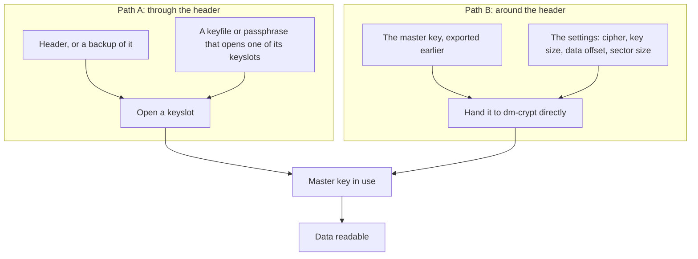

# Case study, part 4: escrow and recovery on the Kafka broker

[← Home](../README.md) · Part 1: [The layers](case-study-kafka-broker.md) · Part 2: [How the keys work](case-study-kafka-keys.md) · Part 3: [Rotating the keyfile](case-study-kafka-key-rotation.md) · Hands-on: [Lab 12](../labs/12-recover-a-locked-out-disk.md)

A broker's data disk is healthy and the data on it is intact, but nobody can open it. The keyfile is lost, or a keyslot was removed by mistake, or the header was overwritten. This part covers what can still be done, and what has to be prepared beforehand for anything to be possible.

## Two things, two kinds of significance

| | The LUKS header | The master key |
|---|---|---|
| What it is | The managed way in | The thing all of that protects |
| Holds | Cipher settings, keyslots, the master key's fingerprint | Nothing else: it *is* the key to the data |
| How many | One per disk, plus any backups | One per disk. Every keyslot holds a copy of the same one |
| Keys can be added, rotated, revoked | Yes | No. Only re-encryption replaces it |
| If it leaks | Old keys in it can be used again | The disk is open to whoever holds it |

The master key belongs to the **volume**, not to a keyslot. Dump it from any keyslot and you get the same bytes.

## Two paths back to the data

Recovery means reaching the master key. There are two independent paths, and each needs two things.



| Path | Needs | Useless on its own |
|---|---|---|
| **A: through the header** | The header (or a backup) **and** a key that opens one of its keyslots | A header backup with no key that opens it: the master key inside stays locked |
| **B: around the header** | The master key **and** the settings | The master key with no settings: you are left guessing |

**You do not need both paths. You need one complete path.** The data is lost only when every path is broken.

## What can be recovered

| What survives | Recoverable? | How |
|---|---|---|
| Header + a working key | Yes | Normal open |
| Header with no keyslots + master key | Yes | Rebuild a keyslot from the master key |
| No header + header backup + a key that opens it | Yes | Restore the backup |
| No header + master key + settings | Yes | Plain dm-crypt |
| No header + master key, settings unknown | Maybe | Trial and error over likely settings |
| Healthy header, only keyfile lost, no other keyslot, no master key | **No** | |
| No header, no backup, no master key | **No** | |

The second-to-last row is the one that catches people: a perfectly healthy disk and header, permanently locked, because the only key was lost.

## Escrow: preparing while the disk is healthy

Escrow means keeping a copy of something that can recover the data, somewhere away from the server. None of these can be created after access is lost.

| What is escrowed | Recovers from | Drawback |
|---|---|---|
| **A recovery key in its own keyslot** | A lost or corrupt primary keyfile | Useless if the header is damaged |
| **A header backup** (plus a key that opens it) | A damaged or erased header | Must be retaken after every keyslot change. Old backups keep old keys alive |
| **The master key** (plus the settings) | Loss of every keyslot, or of the header itself | Cannot be revoked. Whoever gets it bypasses every keyslot |

The difference that matters is revocability. A leaked recovery key is removed and replaced in seconds ([part 3](case-study-kafka-key-rotation.md)). A leaked master key can only be dealt with by re-encrypting the whole disk ([Lab 8](../labs/08-reencrypt.md)).

Exporting the master key and recording the settings:

```bash
cryptsetup luksDump /dev/sdb --dump-volume-key --key-file disk.key --volume-key-file master.key
cryptsetup luksDump /dev/sdb | grep -E 'offset:|cipher:|sector:|Key:'
```

Store the four settings with the master key. They are not secret, and they turn a guessing game into a single command.

## The recoveries

> These commands show the procedures on the case-study broker. Practise all of them in [Lab 12](../labs/12-recover-a-locked-out-disk.md).

### Keyslots lost, header intact

With a header backup:

```bash
cryptsetup luksHeaderRestore /dev/sdb --header-backup-file header.bak
```

With the master key, building a new keyslot for a new keyfile. No existing key is needed:

```bash
cryptsetup luksAddKey /dev/sdb fresh.key --volume-key-file master.key --key-size 512
```

`cryptsetup` checks the supplied master key against the fingerprint still in the header, and refuses a wrong one with `Volume key does not match the volume.`

### Header destroyed

With a header backup, the same restore command as above.

With the master key only, there is no header to add a keyslot to. But LUKS is only the header; dm-crypt does the encryption, and it can be given the key and settings directly:

```bash
cryptsetup open --type plain --cipher aes-xts-plain64 --key-size 512 \
  --key-file master.key --offset 32768 --sector-size 4096 /dev/sdb rescue
mount -o ro /dev/mapper/rescue /mnt/rescue
```

`--offset` is in 512-byte units: a 16 MB header is 16777216 ÷ 512 = 32768.

Plain mode cannot check anything. A wrong setting does not produce an error; it produces a device full of garbage and a mount that fails.

### Master key but settings unknown

Not hopeless. Most disks are formatted with defaults, so there are few likely combinations: the standard cipher, a 16 MB header, a sector size of 512 or 4096. You can tell when you have the right one, because a recognisable filesystem appears. It becomes impractical when unusual options were used and never written down. Treat this as a rescue you might pull off, not one to plan on.

## Supplying your own master key

`cryptsetup` normally gets the master key from the kernel's random number generator. You can supply one instead:

```bash
cryptsetup luksFormat /dev/sdb --key-file disk.key --volume-key-file master.key
```

This is used where the master key must come from a hardware security module or key-management service. Two cautions:

- The key is only as strong as how it was generated. Anything other than a proper random source weakens the whole disk.
- You now hold a file that opens the disk directly and cannot be revoked.

Letting the kernel generate the key and exporting a copy afterwards gives the same recoverability with less to get wrong.

## The other side of every safety net

Anything that can recover the data can also expose it.

| Safety net | If it leaks |
|---|---|
| Recovery keyslot key | Opens the disk until you remove that keyslot |
| Header backup | Revives every key that was valid when it was taken |
| Master key | Opens the disk outright, for as long as that master key is in use |

Escrow moves the risk from "we lose the data" to "someone steals what is in the vault". It only helps if the vault is better protected than the servers.

## The rule

Keep at least two independent ways in, prepared while the disk is healthy, stored so that one accident cannot take both, and guarded as carefully as the data itself.

## Try it

[Lab 12: Recover a locked-out disk](../labs/12-recover-a-locked-out-disk.md) has you erase the keyslots, then destroy the header entirely, and recover the data by both paths each time.
